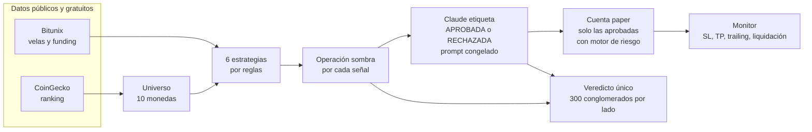

# Minerva: ¿mejora un LLM las señales técnicas de trading?


> ## ⚠ Aviso: solo paper trading, experimental y no es asesoría financiera
>
> **Minerva nunca envía órdenes reales.** Es 100 % *paper trading*: usa solo datos públicos de mercado de Bitunix y
> simula las operaciones localmente. Es un proyecto de investigación **experimental**, **no es asesoría financiera** ni
> una recomendación de inversión. El trading de futuros apalancados (real o simulado) **puede perder dinero** y nada de
> lo que hay aquí garantiza ganancias: que el simulador gane no implica que una cuenta real ganaría, porque la
> ejecución real tiene latencia, comisiones, deslizamiento y límites que el simulador solo aproxima
> ([lo que no se pudo verificar](docs/COSTOS_Y_LIMITES.md#lo-no-verificado)).

## Qué es

Minerva evalúa, en cada cierre de vela, un universo dinámico de las principales criptomonedas con seis estrategias por
reglas; cada señal se simula como una *operación sombra* y Claude (Anthropic) la etiqueta `APROBADA` o `RECHAZADA` con un
prompt **congelado**, mientras una cuenta de papel opera solo las aprobadas a través de un motor de riesgo.
Su único objetivo es **medir con rigor estadístico, y a ciegas, si el filtro de IA aporta valor** sobre las señales por
reglas, antes de que cualquiera piense en dinero real.
Incluye un simulador con comisiones, funding, deslizamiento y liquidación, un dashboard web, un bot de Telegram y todo
empaquetado en Docker.

## El problema que investiga

> Si un modelo de lenguaje revisa cada señal técnica y decide aprobarla o rechazarla, ¿mejora el resultado medio por
> operación frente a operar todas las señales sin filtrar?

Para responderlo sin engañarse, el diseño es deliberadamente estricto: cada señal se simula como una **sombra** (así existe
el contrafactual de las rechazadas), el prompt y el modelo se **congelan** y se vigilan con un hash, el análisis cuenta
**conglomerados** de operaciones solapadas en vez de operaciones, el veredicto se calcula **una sola vez**, con un
**placebo** de calibración previo, y **ningún canal muestra resultados** hasta que exista el registro oficial del veredicto.
Explicado paso a paso y sin jerga: [Metodología](docs/METODOLOGIA.md).

### Estado actual

- **Backtest de las estrategias por reglas (Fase 2): ninguna mostró ventaja demostrable.** Ninguna superó los criterios
  fijados de antemano. Se conservan como *generadores de señales* para la medición, no como estrategias rentables.
- **Medición del valor del LLM: en curso, ciega, con el veredicto pendiente.** Llegar a los 300 conglomerados por lado
  que exige el diseño toma **meses**, y si el efecto real es pequeño lo esperable es un veredicto `INCONCLUSO`.
- **No hay resultados publicados**: la medición es ciega a propósito y este repositorio no incluye ninguno.
- **No hay base para pasar a dinero real.** Y esta versión no tiene ejecución real: solo una interfaz documentada y desactivada.

El último resumen de lo construido, lo verificado y lo no verificado está en el [informe final](docs/INFORME_FINAL.md)
(fotografía del 2026-10-18).

## Cómo funciona



Todo corre en **un solo proceso** (FastAPI + asyncio) con una base SQLite, y expone una API con login, un dashboard web y
un bot de Telegram. Detalle de componentes, flujo y decisiones de diseño: [Arquitectura](docs/ARQUITECTURA.md).

## Funcionalidades

- **Universo dinámico:** las mayores criptomonedas por capitalización (CoinGecko) con perpetuo USDT en Bitunix, sin
  stablecoins ni tokens envueltos, refrescado cada 24 h.
- **Seis estrategias por reglas** (cruce de medias, tendencia con stop ATR, reversión RSI/Bollinger, ruptura de Donchian
  y dos variantes de funding contrario), con backtest propio sin sesgo de anticipación y criterios pre-registrados.
- **Simulador de operaciones:** comisiones, funding, deslizamiento, liquidación en margen aislado, mínimos del contrato,
  SL/TP/trailing evaluados con ticks en vivo y **reconciliación al reiniciar** con velas de 1 minuto. Aproxima la
  ejecución real; no la reproduce ([límites](docs/COSTOS_Y_LIMITES.md#de-la-simulación-frente-a-la-realidad)).
- **Motor de riesgo:** kill switch, stop por drawdown, *circuit breaker*, pérdida diaria, cupos por posición y dirección,
  tope de SL y bloqueo ante datos obsoletos. Solo bloquea entradas, nunca cierres.
- **Medición del valor del LLM:** sombras, etiquetas inmutables, prompt congelado con hash vigilado en cada ciclo, registro
  completo de cada llamada, presupuesto diario con corte duro, placebo y veredicto de tres estados.
- **Resultados ocultos por código** hasta el registro oficial del veredicto, en la API, el dashboard, Telegram y los informes.
- **Dashboard web** de cinco pestañas (resumen, cuenta paper, brazo ejecutado, riesgo y controles, universo) y **API** con
  sesión, de solo lectura salvo tres controles con confirmación.
- **Bot de Telegram:** comandos, avisos de posiciones y riesgo, resumen diario y alerta de caída.
- **Noticias gratuitas y memoria de lecciones** (apagadas durante la medición y fuera del prompt congelado).
- **Operación:** Docker (imagen sin privilegios, puerto solo en `127.0.0.1`), respaldos consistentes, mudanza de
  nativo a Docker con vuelta atrás y más de 2.100 pruebas automáticas de Python y más de 100 del frontend.

## Requisitos

| Para | Necesitas |
|---|---|
| Ejecutar el bot | **Docker** (Docker Desktop, o Docker Engine con Compose v2) y **Git** |
| Herramientas auxiliares (contraseña, respaldos, informes) | **Python 3.11 o 3.12** (no 3.13 ni superiores; en Windows con uv, usa el 3.11: [detalle](docs/GUIA_INSTALACION.md#antes-de-empezar)) |
| La IA (etiquetado) | Una cuenta de la **Claude Console** con facturación. Es lo **único que cuesta dinero**: del orden de 0,005 USD por señal, con tope diario (1 USD por defecto) |
| Avisos y comandos | Un bot de **Telegram** (gratis). Opcional |
| Compilar el dashboard sin Docker | **Node.js 22.22 o superior**. Opcional |

Todo lo demás (datos de mercado, universo, noticias) usa fuentes gratuitas sin tarjeta
([términos y atribuciones](docs/COSTOS_Y_LIMITES.md#fuentes-gratuitas-términos-y-atribuciones)). Desarrollado y probado en
Windows; la imagen de Docker es de Linux.

## Inicio rápido con Docker

```bash
git clone https://github.com/ProyectoJaviera/MinervaV2.git
cd MinervaV2
cp .env.example .env                          # Windows (PowerShell): Copy-Item .env.example .env
docker compose build                          # construye la imagen (~1 min la primera vez)
docker run --rm -it minerva:local python scripts/hash_password.py    # imprime AUTH_PASSWORD_HASH='…'
```

1. **Edita el `.env`**: pega el hash que imprimió el último comando (con sus comillas simples), elige `AUTH_USERNAME`, pon
   un `JWT_SECRET` de al menos 32 caracteres y tu `ANTHROPIC_API_KEY`. Telegram y CoinGecko son opcionales. Paso a paso, con
   cómo conseguir cada credencial: [Guía de instalación](docs/GUIA_INSTALACION.md).
2. **Arranca** y comprueba que esté sano:

   ```bash
   docker compose up -d
   docker compose ps                          # STATUS pasa a "healthy" en ~1 minuto
   ```

3. Abre el dashboard en <http://127.0.0.1:8000/> (con el `AUTH_USERNAME` de tu `.env` y la contraseña que elegiste al
   generar el hash) y el estado en <http://127.0.0.1:8000/health>.

> Sin clave de Anthropic, o para explorar sin gastar, añade `MINERVA_REAL_BOT=false` al `.env`: el bot genera señales y
> sombras pero no llama a ninguna API de pago. No verás resultados de la IA en ningún caso hasta el veredicto: **la
> medición es ciega** y toma meses.

## Documentación

Índice completo: [`docs/README.md`](docs/README.md).

| Documento | Para qué |
|---|---|
| [Guía de instalación](docs/GUIA_INSTALACION.md) | Instalar desde cero, conseguir cada credencial, primer arranque y verificación |
| [Configuración](docs/CONFIGURACION.md) | Todas las variables y los interruptores |
| [Uso diario](docs/USO.md) | Dashboard, Telegram, respaldos, reinicios seguros, actualizar y mudar |
| [Arquitectura](docs/ARQUITECTURA.md) | Componentes, flujo de datos, base de datos y decisiones de diseño |
| [Metodología](docs/METODOLOGIA.md) | Qué se mide, cómo y por qué los resultados están ocultos |
| [Solución de problemas](docs/SOLUCION_PROBLEMAS.md) | Preguntas frecuentes y errores comunes |
| [Seguridad](docs/SEGURIDAD.md) | Secretos, puertos, autenticación y cómo reportar un problema |
| [Costos y límites](docs/COSTOS_Y_LIMITES.md) | Costo medido, fuentes gratuitas y lo no verificado |
| [Glosario](docs/GLOSARIO.md) | Los términos del proyecto |
| [Informe final](docs/INFORME_FINAL.md) | Qué se construyó, qué está verificado y qué no |
| [Historial de desarrollo](docs/historial/README.md) | Cómo se construyó, fase por fase, con ayuda de IA |

## Estructura del repositorio

```text
app/            Backend (FastAPI + asyncio): API, mercado, estrategias, riesgo, LLM, Telegram, persistencia
frontend/       Dashboard (React + Vite + Tailwind) con pruebas de Vitest
scripts/        Arranque y parada, respaldos, informes de la medición y del veredicto, mudanza a Docker
tests/          unit/, integration/, e2e/ y support/ (pruebas unitarias, de integración y de punta a punta)
docker/         Healthcheck, versiones exactas de dependencias y certificados opcionales
docs/           Documentación; docs/historial/ es el registro del desarrollo
.github/        Plantillas de issues y de pull requests
```

## Pruebas y contribuciones

```bash
pytest                               # unitarias, de integración y de punta a punta (~11 min)
ruff check .
npm --prefix frontend run test       # Vitest
npm --prefix frontend run build
```

Las pruebas no necesitan red ni credenciales (un candado bloquea cualquier conexión a un nombre que no sea local). Cómo
contribuir, las convenciones y la regla de no tocar el prompt congelado durante una medición:
[`CONTRIBUTING.md`](CONTRIBUTING.md). Cambios por fase: [`CHANGELOG.md`](CHANGELOG.md).

El proyecto se construyó con ayuda de un asistente de IA (Claude Code), fase por fase y con aprobación del autor en cada
una; las instrucciones que se le dieron están en [`CLAUDE.md`](CLAUDE.md).

## Licencia

[MIT](LICENSE).

---

## English summary

### About

**Minerva** is an experimental research bot that asks one question: *does an LLM filter improve the average result of
rule-based technical trading signals?* On every candle close it evaluates a dynamic universe of the largest crypto
perpetuals (Bitunix, ranked by CoinGecko) with six rule-based strategies. Each signal becomes a simulated *shadow trade*;
Claude (Anthropic) labels it `APROBADA` (approved) or `RECHAZADA` (rejected) with a **frozen** prompt; and a paper account
trades only the approved ones through a risk engine. The measurement is **blind**: no channel shows results until a single,
pre-registered analysis point (300 effective clusters per side) and an official verdict record exist. Status: the rule-based
strategies showed no demonstrable edge in backtest; the LLM measurement is running and the verdict is pending (months away);
no results are published. Documentation is in Spanish; code identifiers are in English.

### Quick start

```bash
git clone https://github.com/ProyectoJaviera/MinervaV2.git && cd MinervaV2
cp .env.example .env
docker compose build
docker run --rm -it minerva:local python scripts/hash_password.py   # paste the printed line into .env
# edit .env: AUTH_USERNAME, AUTH_PASSWORD_HASH, JWT_SECRET (>= 32 chars), ANTHROPIC_API_KEY
docker compose up -d
```

Open <http://127.0.0.1:8000/> (dashboard) and <http://127.0.0.1:8000/health>. Requirements: Git, Docker with Compose v2,
Python 3.11/3.12 for helper scripts, and an Anthropic API key (the only paid component; about 0.005 USD per labeled
signal, with a hard daily cap). Full guide (in Spanish): [`docs/GUIA_INSTALACION.md`](docs/GUIA_INSTALACION.md).

### Disclaimer

**Paper trading only. Experimental. Not financial advice.** Minerva never sends real orders and has no exchange
credentials. Trading leveraged futures, real or simulated, can lose money, and nothing here guarantees profit. Simulated
results do not predict real-account results (latency, fees, slippage and exchange limits are only approximated). Provided
"as is" under the [MIT license](LICENSE), without warranty of any kind.
