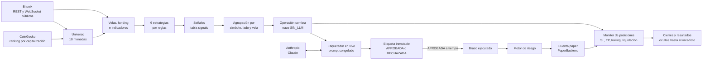
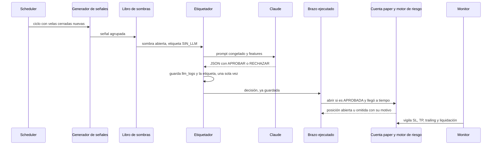
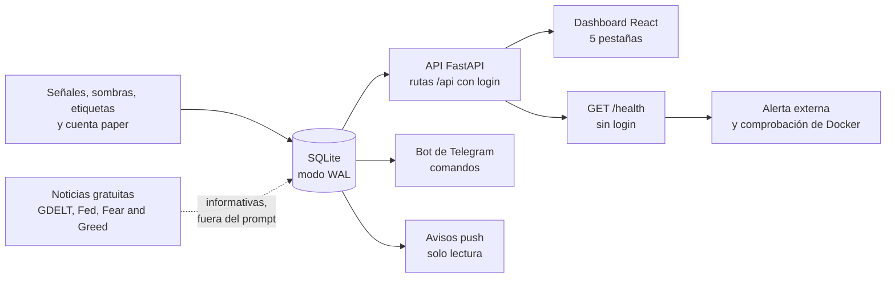

# Arquitectura

Cómo está armado Minerva por dentro: componentes, flujo de datos, base de datos, aislamiento entre tareas y las
decisiones de diseño que explican por qué es así. Para el *qué mide y por qué* lee la
[metodología](METODOLOGIA.md); para operarlo, el [uso diario](USO.md).

## Visión general

Minerva es **un solo proceso** de Python (FastAPI + `asyncio`) con una base de datos SQLite. Ese proceso:

1. Descubre cada 24 horas un **universo** de monedas (las de mayor capitalización según CoinGecko que tengan perpetuo
   USDT en Bitunix).
2. Descarga **velas** y **funding** públicos de Bitunix y vigila los precios por WebSocket.
3. En cada cierre de vela evalúa **seis estrategias por reglas** y registra cada evaluación como una **señal**.
4. Convierte cada señal accionable en una **operación sombra** (una simulación sin límites de margen) y pide a
   **Claude** que la etiquete `APROBADA` o `RECHAZADA` con un **prompt congelado**.
5. Abre posiciones en una **cuenta paper** (dinero simulado) solo con las aprobadas que llegaron a tiempo, a través de
   un **motor de riesgo**, y las vigila con un **monitor** de SL, TP, trailing y liquidación.
6. Expone todo por una **API con login**, un **dashboard** web, un **bot de Telegram** y **avisos push**.

Pila: Python 3.11–3.12, FastAPI, `aiosqlite`, `pandas` (indicadores), `httpx` y `websockets`, SDK oficial de Anthropic;
frontend con React 18, Vite, Tailwind y TanStack Query; Docker para empaquetarlo.

## Flujo de datos

**Una señal, paso a paso:**

1. **Cierre de vela.** Cada 60 segundos (`SCHEDULER_POLL_SECONDS`) el scheduler busca velas cerradas nuevas. Las de 1 h
   cierran cada hora, las de 4 h a las 00, 04, 08, 12, 16 y 20 UTC y la de 1 d a las 00 UTC.
2. **Evaluación.** Cada estrategia evalúa su símbolo y timeframe; cada evaluación queda en `signals`, incluso las que
   no dicen nada (`HOLD`).
3. **Agrupación.** Las señales accionables de un mismo símbolo, lado y vela se agrupan en una sola (con una estrategia
   *representante*, preferentemente una elegible para la cuenta paper).
4. **Sombra.** Se abre **una** operación sombra por grupo, al precio de cierre de la vela y sin demora. Usa las mismas
   funciones que la cuenta paper para comisiones, deslizamiento, funding y cierre, pero sin límites de margen ni de
   cupos, para que la comparación no dependa de los límites de riesgo.
5. **Etiquetado.** El etiquetador envía a Claude el mensaje con las *features* de la señal. La respuesta (un JSON
   validado con un esquema) se guarda **completa** en `llm_logs` y la etiqueta se escribe **una sola vez** en la sombra
   (un disparador de la base impide cambiarla). Un fallo, un tiempo agotado o el presupuesto diario agotado dejan
   `SIN_LLM`, nunca `RECHAZADA`: un fallo técnico no es un juicio negativo.
6. **Brazo ejecutado.** *Después* de guardar la etiqueta, si es `APROBADA` y la decisión llegó en 60 segundos o menos
   (`LLM_REAL_MAX_DELAY_SECONDS`), el brazo pide abrir una posición paper. Cada decisión que considera, abierta u
   omitida, queda registrada con su motivo en `paper_execution_log`.
7. **Motor de riesgo.** Rechaza la entrada si el kill switch, el stop por drawdown, el *circuit breaker* o la pérdida
   diaria están activos, si los datos están obsoletos, si la estrategia no es elegible, si se superan los cupos
   (posiciones totales y por dirección) o el tope de SL. Solo bloquea **entradas**, nunca cierres; cada rechazo queda
   auditado. Además, el simulador omite la entrada si el tamaño no alcanza el mínimo operable del contrato.
8. **Monitor.** Vigila SL, TP, trailing y liquidación con ticks en vivo (WebSocket, con consulta REST de respaldo) y
   acumula el funding. Al **reiniciar**, reconstruye con velas de 1 minuto lo que habría ocurrido con el bot apagado.
9. **Cierre.** Se registran precio de salida, comisiones, funding, deslizamiento y PnL. Los resultados no se muestran
   por ningún canal hasta que exista el registro oficial del veredicto.

## Las seis estrategias

Son reglas simples de la literatura, con parámetros fijos y sin optimizar. No se presentan como estrategias
rentables (el backtest no encontró ventaja en ninguna): son **generadores de señales** para medir si el filtro de IA
aporta valor sobre ellas.

| Estrategia | Familia y regla (resumen) | Timeframe |
|---|---|---|
| `ema_cross_9_21` | Cruce de medias exponenciales de 9 y 21 periodos | 4 h |
| `trend_atr_stop_9_21_50` | Tendencia: cruce 9/21 a favor de la EMA de 50, con stop y trailing por ATR | 4 h |
| `mean_reversion_rsi14_bb20` | Reversión a la media: RSI(14) extremo con cierre en la banda de Bollinger(20, 2) | 1 h |
| `donchian_breakout_20` | Ruptura del canal de Donchian de 20 periodos | 4 h y 1 d |
| `funding_contrarian_experimental` | Contraria al posicionamiento de la mayoría según el funding (umbral fijo) | 4 h |
| `funding_contrarian_percentile_experimental` | Igual, con un umbral relativo (percentil del propio funding) | 4 h |

Las dos de funding son **experimentales**: no participan en el veredicto de descarte del backtest. Qué estrategias
pueden abrir posiciones en la cuenta paper lo fija `REAL_ACCOUNT_ELIGIBLE_STRATEGIES`.

## Componentes

| Pieza | Dónde está | Qué hace |
|---|---|---|
| Arranque y ciclo de vida | [`app/main.py`](../app/main.py) | Construye todo, lanza las tareas, cierra ordenadamente. Pone el encabezado `X-Minerva-Mode: PAPER_TRADING` en cada respuesta |
| Scheduler, latido, registros | [`app/core/`](../app/core/) | Ciclo de señales cada 60 s; latido del proceso; *logging* no bloqueante; cliente HTTP único (usa el almacén de certificados del sistema) |
| Mercado | [`app/market/`](../app/market/) | Clientes de Bitunix (REST y WebSocket) y CoinGecko, caché de velas y funding con reparación de huecos, especificaciones de contrato, universo |
| Indicadores | [`app/indicators/engine.py`](../app/indicators/engine.py) | EMA, RSI, ATR, Bollinger y Donchian con `pandas` |
| Estrategias | [`app/strategies/`](../app/strategies/) | Las seis reglas y su registro |
| Señales, sombras, riesgo, monitor | [`app/trading/`](../app/trading/) | Generador de señales, libro de sombras, etiquetador en vivo, brazo ejecutado, motor de riesgo, monitor de posiciones, estado de la medición, veredicto, placebo, informes |
| Ejecución simulada | [`app/execution/`](../app/execution/) | `PaperBackend` (la única implementación activa), cálculo de PnL; `BitunixBackend` es solo una interfaz documentada y desactivada |
| LLM | [`app/llm/`](../app/llm/) | Prompt congelado y *features*, cliente de Anthropic, servicio de decisión, esquema de la respuesta, presupuesto con corte duro |
| Persistencia | [`app/persistence/`](../app/persistence/) | Esquema, migraciones aditivas y repositorios sobre `aiosqlite` |
| API | [`app/api/`](../app/api/) | Rutas, autenticación y serializadores con listas blancas |
| Telegram | [`app/telegram/`](../app/telegram/) | Bot de comandos por *long-polling*, avisos push, confirmación de dos pasos |
| Noticias y memoria | [`app/news/`](../app/news/), [`app/memory/`](../app/memory/) | Recolección gratuita de noticias y memoria de lecciones. Apagadas durante la medición |
| Backtest | [`app/backtesting/`](../app/backtesting/) | Motor de la Fase 2 (sin sesgo de anticipación) y sus informes |
| Dashboard | [`frontend/src/`](../frontend/src/) | Aplicación React que se compila y la sirve el propio FastAPI en `/` |
| Operación | [`scripts/`](../scripts/) | Arranque, respaldos, informes, veredicto, mudanza a Docker |
| Empaquetado | [`Dockerfile`](../Dockerfile), [`docker-compose.yml`](../docker-compose.yml), [`docker/`](../docker/) | Imagen multietapa, volúmenes, comprobación de salud |

## Tareas del proceso y aislamiento

Dentro del proceso corren tareas `asyncio` separadas. Las **centrales** son el cliente WebSocket, el monitor, el
scheduler, el refresco del universo y el latido. Las **opcionales** tienen su propio interruptor, apagado por
defecto:

| Pieza opcional | Interruptor | Cómo se aísla |
|---|---|---|
| Etiquetado en vivo | `LLM_LIVE_LABELING_ENABLED` | Una tarea por sombra, "fuego y olvido": nunca bloquea el ciclo de señales |
| Brazo ejecutado | `PAPER_EXECUTION_ENABLED` | Tarea propia, con captura total de excepciones; se entera de cada decisión *después* de que la etiqueta quedó guardada |
| Bot de Telegram | `TELEGRAM_COMMANDS_ENABLED` | Tarea propia con reintentos y *backoff* |
| Avisos push | `TELEGRAM_PUSH_ENABLED` | Tarea propia que solo *lee* la base; el núcleo no tiene ganchos hacia ella |
| Noticias | `NEWS_COLLECTION_ENABLED` | Tarea propia, sin costo de Anthropic, fuera del prompt |
| Memoria de lecciones | `LESSONS_MEMORY_ENABLED` | Tarea propia; nunca muestra PnL sin el registro oficial |

La regla de diseño es que **un fallo de una pieza opcional no alcanza al scheduler, al etiquetado ni al monitor**:
construirla no puede lanzar, toda excepción se captura y se registra por tipo (nunca la URL ni el token), y hay
pruebas de aislamiento (una pieza que lanza, otra que se cuelga, otra que se cancela al apagar) y de importaciones
(por AST, el etiquetador no puede importar noticias ni memoria). Los detalles de cada interruptor están en
[Configuración](CONFIGURACION.md#interruptores).

## Base de datos

SQLite en modo **WAL** con una sola conexión `aiosqlite` y un candado de escritura. Las fechas son texto ISO-8601 en
UTC y los tiempos de vela, milisegundos Unix. El esquema se crea y se amplía solo, con migraciones **aditivas**
(`CREATE TABLE IF NOT EXISTS`, columnas nuevas), así que arrancar una versión nueva sobre una base vieja no destruye
nada. Tiene 28 tablas, agrupadas por tema:

| Tema | Tablas principales |
|---|---|
| Cuenta paper, riesgo y control | `trades`, `system_state` (pausa, kill switch, *circuit breaker*, contadores), `risk_rejections`, `paper_execution_log`, `control_audit` |
| Señales, sombras y medición | `signals`, `signals_discarded_by_sl_cap`, `shadow_trades`, `llm_logs` |
| Mercado y salud | `ohlcv_cache`, `funding_cache`, `contract_specs_cache`, `asset_universe`, `data_source_health` y tablas de integridad de velas |
| Backtest | `backtest_runs`, `backtest_trades`, `backtest_skipped_entries`, `backtest_verdicts` |
| Noticias y memoria | `news_items`, `news_fetch_state`, `fear_greed`, `memory_entries`, `lessons`, `lesson_applications`, `lessons_reports` |

Garantías que da la propia base: un **disparador** (`llm_decision_inmutable`) impide cambiar la etiqueta de una sombra
una vez decidida, y `llm_logs` guarda el mensaje enviado, la respuesta cruda, los tokens y el costo de cada llamada.
Esquema completo, columna por columna: [ESQUEMA_BD.md](ESQUEMA_BD.md) (se genera desde el código y una prueba vigila
que no se desactualice).

## Qué ve cada canal

- **API:** 22 rutas en total, **solo tres escriben**: login, logout y `POST /api/control/{pause|resume|kill}`.
  Sin login solo se sirven `GET /health`, `GET /positions` y `GET /trades` (con listas blancas de campos). Las rutas
  están en [`app/api/routes/`](../app/api/routes/).
- **Dashboard:** cinco pestañas (*Resumen*, *Cuenta paper*, *Brazo ejecutado*, *Riesgo y controles* y *Universo y
  backtest*). Ver [Uso diario](USO.md#el-dashboard).
- **Telegram:** siete comandos y avisos. Ver [Uso diario](USO.md#telegram).
- **La puerta de resultados** ([`app/trading/reveal.py`](../app/trading/reveal.py)) decide si un canal puede mostrar PnL,
  saldo, precios de salida o motivos de cierre: solo si el *gate* de la medición está abierto **y** existe el registro
  oficial del veredicto. Falla cerrada: ante cualquier error, no se muestra nada. El servidor no consulta siquiera el
  PnL con la puerta cerrada, y el navegador tampoco lo calcula nunca.

## Docker

La imagen es multietapa (compila el dashboard con Node, instala las dependencias de Python con versiones exactas y
deja una imagen final sin Node ni compiladores), corre como usuario sin privilegios y no lleva secretos. El
`docker-compose.yml` publica el puerto solo en `127.0.0.1`, guarda la base y los logs en **volúmenes con nombre**
(`minerva_data` y `minerva_logs`; SQLite en modo WAL no es fiable sobre las carpetas compartidas de Docker Desktop),
monta el `.env` y `docs/` de solo lectura y define un *healthcheck* sobre `/health`. Más en
[Seguridad](SEGURIDAD.md#el-contenedor).

## Decisiones de diseño clave

1. **Paper puro, ejecución real solo como interfaz.** Es la regla crítica y la hacen cumplir pruebas (por AST), no la
   disciplina.
2. **Pre-registrar los criterios antes de ver resultados.** Lo hizo el backtest (Fase 2) y lo hace el veredicto del
   LLM. Es lo que permitió reportar "ninguna estrategia pasa" sin discusión.
3. **Operaciones sombra en lugar de dos cuentas.** Cada señal tiene una sombra con el mismo cálculo de costos, así
   aprobadas y rechazadas se comparan sobre el *mismo* universo de señales. La sombra **no bloquea por solapes**
   (bloquear sesgaría la comparación), así que el análisis cuenta **conglomerados** de operaciones solapadas.
4. **Un único punto de análisis.** 300 conglomerados efectivos por lado, una sola mirada, un solo registro oficial.
5. **Medición ciega aplicada por código.** La puerta de resultados falla cerrada, se aplica con listas blancas y se
   comprueba con un barrido sobre todos los canales.
6. **Congelar el prompt y vigilarlo en cada ciclo.** El hash cubre el texto *y* las *features*; si no coincide, el
   etiquetado se detiene solo. Cuando un defecto resistió la explicación en texto (el signo del funding en SHORT), se
   resolvió **calculándolo** en código, no pidiéndoselo al modelo.
7. **Todo lo nuevo, apagado por defecto y aislado.** Cada pieza opcional tiene su interruptor y su tarea.
8. **Proceso único con SQLite en modo WAL.** Simple de operar y suficiente; el costo es un único punto de falla y que
   un apagado duro corta lo que esté en vuelo (de ahí la [ventana segura de reinicio](USO.md#reinicios-seguros)).
9. **Reconciliar al arrancar.** Los SL, TP y liquidaciones que habrían ocurrido con el bot apagado se reproducen con
   velas de 1 minuto; si faltan más de dos velas, la posición queda abierta con un aviso crítico.
10. **Fuentes externas solo gratuitas y con sus términos verificados.** Lo único que cuesta dinero es la API de
    Anthropic, con tope diario y corte duro. Las fuentes gratuitas se tratan como poco fiables: caché local, reintentos
    con espera, salud por fuente y bloqueo de nuevas entradas ante datos críticos obsoletos.

## Qué no hace

- No envía órdenes reales ni usa credenciales de Bitunix.
- No cierra posiciones ni edita parámetros de riesgo desde el dashboard o Telegram (solo pausa, reanuda y kill switch).
- No deja que la IA fije niveles ni cierres: la IA **filtra** señales de estrategias por reglas; los niveles vienen
  de la estrategia y los cierres son mecánicos. Es lo que permite medir su aporte contra un contrafactual.
- No usa las noticias ni la memoria de lecciones en el prompt de la medición.
- No tiene tiempo real por WebSocket hacia el navegador (el dashboard consulta periódicamente la API).
