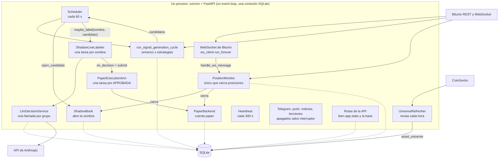

# Flujo de ejecución

Cómo arranca el bot, qué tareas corren, cómo se hablan entre sí, qué pasa en un cierre de vela
de punta a punta, en un reinicio y en una parada. Todo está verificado leyendo el código; lo que no
se pudo comprobar está marcado en [Lo no verificado](#lo-no-verificado).

## El proceso en una página

Minerva es **un solo proceso** (uvicorn con FastAPI, `app.main:app`), **un solo event loop**
asyncio y **una sola conexión SQLite** compartida (`app/persistence/database.py`, modo WAL, con un
candado de escritura). No hay colas ni hilos entre las tareas de negocio: se hablan de dos maneras.

- **Llamadas directas** entre objetos que `lifespan` construye y conecta (el WebSocket llama al
  monitor, el scheduler llama a la sombra y al etiquetador, el etiquetador llama al brazo).
- **La base como bus**: `system_state` (pausa, kill switch, última hora vista del monitor...) y
  `data_source_health` (el latido del feed). Quien lee un valor no sabe quién lo escribió.



Las líneas punteadas son lecturas y escrituras a la base. La relación completa entre paquetes está
en [`README.md`](README.md#mapa-de-dependencias-entre-paquetes).

## El `lifespan` paso a paso

`lifespan` (`app/main.py`) arma todo al arrancar y lo desarma al parar. El orden importa:

| # | Paso | Qué hace | Si falla |
|---|---|---|---|
| 1 | `setup_logging()` | colas de log y archivo rotativo (`logs/minerva.log`, 5 x 10 MB); escribir un log nunca bloquea el event loop | el bot no arranca |
| 2 | aviso `warn_if_jwt_secret_is_unsafe` | avisa si `JWT_SECRET` es débil | solo avisa |
| 3 | `Database.connect()` | abre SQLite, activa WAL, crea las tablas que falten y agrega las columnas migradas (`init_schema`) | el bot no arranca |
| 4 | `BitunixRestClient` | un solo cliente REST con limitador de ritmo (`BITUNIX_RATE_LIMIT_PER_SEC`) que comparten el generador, el monitor y el brazo | — |
| 5 | `PaperBackend`, `ShadowBook`, `PositionMonitor` | la cuenta paper, el libro de sombras y el monitor que vigila las dos | — |
| 6 | `BitunixPublicWSClient` | su `on_message` es `monitor.handle_ws_message`; arranca sin símbolos | — |
| 7 | `PaperExecutionArm` y `ShadowLiveLabeler` | el brazo se conecta como `on_decision` del etiquetador; construirlos no activa nada, cada uno decide por su interruptor | — |
| 8 | `Scheduler`, `CoinGeckoClient`, `UniverseRefresher`, `Heartbeat` | los objetos de las tareas permanentes | — |
| 9 | `monitor.reconcile_on_startup()` | reproduce con velas de 1 minuto el periodo en que el proceso estuvo caído, **antes** de abrir el feed y el generador | se registra CRITICAL y **no impide arrancar**; la posición queda marcada y se reintenta |
| 10 | `paper_arm.activate()` | arma el brazo ejecutado si `PAPER_EXECUTION_ENABLED` y no hay `AUTO_OPEN_WITHOUT_LLM`; resuelve las filas `PENDING` que dejó un reinicio | se registra CRITICAL, `active = False` y **no impide arrancar** |
| 11 | `monitor.start_feed()` y `scheduler.sync_ws_subscriptions()` | escribe el latido `ws_feed` (sin esa fila el motor de riesgo no comprueba el feed) y suscribe el WebSocket al universo vigente más los símbolos con posición abierta | — |
| 12 | `app.state.*` | cuelga de `app.state` la base, el backend, el monitor, el scheduler, el latido, el etiquetador, el brazo y `settings` (las rutas los reciben por `app/api/deps.py`) | — |
| 13 | las cinco tareas permanentes | `ws_client.run_forever`, `monitor.run_forever`, `scheduler.run_forever`, `universe_refresher.run_forever` y `heartbeat.run_forever` | — |
| 14 | tareas opcionales | `maybe_start_telegram_bot`, `maybe_start_push_notifier`, `maybe_start_news_collector` y `maybe_start_lessons_runner`; cada una devuelve `None` si su interruptor está apagado y **nunca lanza** | queda desactivada; el resto sigue |
| 15 | `yield` | recién aquí la API empieza a atender peticiones | — |

El orden de los pasos 9 a 11 es deliberado: primero se reconcilia, después se abre el feed y el
generador, para que ningún tick nuevo entre antes de que el periodo caído se haya reproducido.

## Las tareas asyncio

| Tarea | Objeto | Cadencia | Interruptor | Lee | Escribe | Si falla |
|---|---|---|---|---|---|---|
| WebSocket | `BitunixPublicWSClient.run_forever` (`app/market/bitunix_ws.py`) | conexión permanente; ping cada 15 s | siempre | — | — (entrega cada mensaje al monitor) | reconecta con backoff exponencial, tope 60 s |
| Monitor | `PositionMonitor.run_forever` (`app/trading/position_monitor.py`) | `tick_periodic` cada `MONITOR_TICK_SECONDS` (15 s) y una evaluación por cada tick del WebSocket | siempre | `trades`, `shadow_trades`, `funding_cache`, `system_state` | `trades`, `shadow_trades`, `data_source_health` (`ws_feed`), `system_state` (`monitor_last_seen_ms`) | el ciclo fallido se registra y el bucle sigue |
| Scheduler | `Scheduler.run_forever` (`app/core/scheduler.py`) | `SCHEDULER_POLL_SECONDS` (60 s) | siempre; se pausa con `/pause`, `/kill` o el dashboard | ver "Un cierre de vela" | `signals`, `signals_discarded_by_sl_cap`, `shadow_trades`, cachés de mercado | el ciclo fallido se registra y el bucle sigue |
| Universo | `UniverseRefresher.run_forever` (`app/market/universe.py`) | revisa cada 3600 s; refresca si pasaron `UNIVERSE_REFRESH_HOURS` (24) | siempre | `asset_universe` | `asset_universe`, `system_state` (`universe_last_refresh_error`) | conserva el snapshot anterior |
| Latido | `Heartbeat.run_forever` (`app/core/heartbeat.py`) | cada `HEARTBEAT_SECONDS` (300 s) | siempre | — | una línea de log con `last_beat_at` | — |
| Bot de Telegram | `TelegramBot.run_forever`, dentro de `run_isolated` (`app/telegram/`) | long-polling de 30 s | `TELEGRAM_COMMANDS_ENABLED` | según el comando | `/pause`, `/resume` y `/kill` escriben `system_state` y `control_audit` | backoff exponencial hasta 300 s; nunca llega al resto |
| Push | `PushNotifier.run_forever` | `TELEGRAM_PUSH_POLL_SECONDS` (10 s, mínimo 2) tras 15 s de espera | `TELEGRAM_PUSH_ENABLED` | `trades`, `asset_universe`, `system_state` | `system_state` (`push_state`) | espera creciente hasta 5 min |
| Noticias | `NewsCollector.run_forever` (`app/news/collector.py`) | cada 60 s revisa qué fuentes están vencidas (cada una con su intervalo mínimo), tras 60 s de espera | `NEWS_COLLECTION_ENABLED` | `news_fetch_state`, `asset_universe` | `news_items`, `news_fetch_state`, `data_source_health` | una fuente caída no afecta a las demás ni al bot |
| Lecciones | `LessonsRunner.run_forever` (`app/memory/runtime.py`) | cada `LESSONS_REBUILD_HOURS` (24 h), tras 300 s de espera | `LESSONS_MEMORY_ENABLED` (**apagada** durante la medición) | resultados | tablas de memoria | aislada |
| Etiquetado (fuego y olvido) | `ShadowLiveLabeler._label_one`, una tarea por sombra | por evento | `LLM_LIVE_LABELING_ENABLED` | `shadow_trades`, `signals`, `ohlcv_cache`, `trades`, `llm_logs` | `llm_logs`, `shadow_trades.llm_decision` | se registra con `exc_info`; la sombra queda `SIN_LLM` |
| Brazo ejecutado (fuego y olvido) | `PaperExecutionArm._run`, una tarea por APROBADA | por evento | `PAPER_EXECUTION_ENABLED` | `system_state`, `trades`, `contract_specs_cache` | `paper_execution_log`, `trades`, `risk_rejections` | queda `SKIPPED/OPEN_ERROR` (solo el tipo); no llega al etiquetador |

Las cuatro tareas opcionales (Telegram, push, noticias, lecciones) comparten el mismo patrón de
aislamiento: se construyen con una función `build_*` que no lanza, corren dentro de `run_isolated`,
que captura cualquier `Exception`, y se agregan a la lista de tareas del `lifespan` para que el
cierre las cancele igual que a las demás. Una prueba de aislamiento por cada una vigila que nada
del núcleo las importe (ver [`PRUEBAS.md`](PRUEBAS.md)).

## Cómo se comunican

**Llamadas directas** (el hilo de una decisión):

```
WebSocket ──handle_ws_message──> PositionMonitor
Scheduler ──open_candidate──> ShadowBook          (abre la sombra)
Scheduler ──maybe_label(sombra, candidato)──> ShadowLiveLabeler   (crea una tarea y vuelve)
ShadowLiveLabeler ──decide_group──> LlmDecisionService            (guarda la etiqueta)
ShadowLiveLabeler ──on_decision = PaperExecutionArm.submit──>      (DESPUÉS de guardar la etiqueta)
PaperExecutionArm ──open_position──> PaperBackend ──> risk_engine
PositionMonitor ──close──> ShadowBook / PaperBackend
```

Dos garantías que dependen de este diseño:

- **La etiqueta se guarda antes de que el brazo se entere.** `_label_one` llama a
  `_dispatch_decision` solo después de que `decide_group` volvió, y `decide_group` ya escribió
  `llm_logs` y `shadow_trades.llm_decision`. El gancho nunca lanza y corre en su propia tarea: un
  fallo del brazo no cambia el etiquetado.
- **Los candidatos viajan solo en memoria.** El generador devuelve la lista de `SignalCandidate` al
  scheduler; no se persiste en ningún sitio. Lo que sí queda en la base es la fila de `signals`
  (con `INSERT OR IGNORE`) y, después, la sombra.

**La base como bus** (claves de `system_state` y filas de `data_source_health`):

| Quién escribe | Qué | Quién lee |
|---|---|---|
| comandos de pausa y kill (`control_actions`) | `scheduler_paused`, kill switch | `Scheduler.run_cycle`, el brazo, `GET /health` |
| `PositionMonitor` | `monitor_last_seen_ms`; `ws_feed` en `data_source_health` | `reconcile_on_startup`; el motor de riesgo (bloquea aperturas con el feed obsoleto) |
| `risk_engine` | estado de riesgo (equity, picos, circuit breaker, stop por drawdown) | el motor de riesgo, `GET /api/risk`, el push |
| `signal_generator` | `signals_stale_data_count` | informes |
| `UniverseRefresher` | `universe_last_refresh_error` | `GET /api/universe` |
| `PushNotifier` | `push_state` | `PushNotifier` |
| `PaperExecutionArm.activate` | `real_arm_started_at`, `real_arm_drawdown_baseline` (una sola vez) | el reporte de paso a dinero real |

**Lo que comparten las tareas** y por eso se serializa: el candado de escritura de `Database`, el
candado de `ShadowBook`, el semáforo de concurrencia del LLM (`LLM_MAX_CONCURRENCY`) y el candado
del presupuesto diario, y el limitador de ritmo del cliente REST de Bitunix.

**`app.state`** es lo que ven las rutas (`app/api/deps.py` expone `get_db`, `get_scheduler`,
`get_live_labeler`, `get_paper_arm`, `get_push_notifier`...). Si añades un objeto que una ruta
necesita, cuélgalo de `app.state` en el `lifespan` y agrega su `get_*`.

## Un cierre de vela de punta a punta

Ejemplo: cierra una vela de 4 horas a las 12:00 UTC. Las de 1 hora cierran cada hora, las de 4
horas a las 00, 04, 08, 12, 16 y 20 UTC y la de 1 día a las 00 UTC.

**1. El scheduler la nota** (hasta `SCHEDULER_POLL_SECONDS` = 60 s después). `Scheduler.run_cycle`:

1. Si el scheduler está pausado devuelve una lista vacía **sin** avanzar `last_cycle_at` (así
   `GET /health` pasa a `stale`).
2. `live_labeler.note_cycle_start()` compara `PROMPT_SHA256` con `FROZEN_PROMPT_SHA256` una vez
   por ciclo.
3. `run_signal_generation_cycle`:
   - con el universo obsoleto (`UNIVERSE_STALENESS_HOURS`) o vacío no genera nada;
   - para cada símbolo del universo: `_refresh_funding` (contrato y funding), y para cada grupo de
     timeframe (1h, 4h, 1d) `_load_closed_bars` descarga las velas que falten por REST y descarta
     la que se está formando; solo se evalúa **la última vela cerrada** de cada símbolo y timeframe;
   - cada estrategia evalúa con `precompute` y `evaluate` (el mismo código del backtest) y
     `_evaluate_one` escribe **una fila de `signals`** (`INSERT OR IGNORE`: si la vela ya estaba,
     no se reprocesa); una vela atrasada o un funding obsoleto marcan la fila y vetan la señal;
   - a cada señal accionable se le calcula `sl_margin_loss_pct`; si pasa de
     `LIVE_SL_MARGIN_CAP_PCT` queda `DISCARDED_SL_CAP` y se audita;
   - `_group_actionable_signals` agrupa por (símbolo, dirección, vela) en un `SignalCandidate`.
4. Para cada candidato, el scheduler:
   - `ShadowBook.open_candidate` elige la estrategia representante, calcula el llenado y los
     niveles y hace `INSERT OR IGNORE` de la sombra por `signal_group_key`;
   - si abrió la sombra, `maybe_label(sombra, candidato)` **crea una tarea y vuelve**;
   - `_process_candidate` solo abre en la cuenta paper si `AUTO_OPEN_WITHOUT_LLM` está encendido
     (apagado y debe seguir así).
5. `sync_ws_subscriptions()` y `last_cycle_at = ahora`.

**2. El etiquetado** (en su propia tarea, mientras el ciclo sigue). `_label_one`:

1. relee la sombra: si ya no está `OPEN` o si `decision_delay_s` supera
   `MAX_LABELING_DELAY_SECONDS` (1800 s) **no se etiqueta**: queda `SIN_LLM` sin fila en `llm_logs`
   y fuera de la medición;
2. `build_features_from_shadow_trade` arma las features con lo ya calculado en el cierre y
   `build_user_message` el mensaje;
3. `decide_group`: toma el semáforo, reserva el costo máximo del presupuesto diario (si no hay,
   fila `BUDGET_EXCEEDED`), llama al modelo, valida con `parse_decision`, escribe **una fila en
   `llm_logs`** (siempre) y, con una decisión válida, la etiqueta inmutable en la sombra;
4. `_dispatch_decision` avisa al brazo.

**3. El brazo ejecutado** (solo con `PAPER_EXECUTION_ENABLED`, en otra tarea). `PaperExecutionArm.handle`
aplica, en orden: etiqueta distinta de `APROBADA` (nada); reclamo idempotente del grupo
(`paper_execution_log`); decisión tardía (`LATE_DECISION`, más de `LLM_REAL_MAX_DELAY_SECONDS` = 60
s); scheduler pausado; símbolo con posición abierta; sin especificación de contrato; bajo el tamaño
mínimo de orden; y por fin `PaperBackend.open_position`, que pasa por el motor de riesgo
(`RISK_<código>` si lo rechaza). Cada decisión deja su fila con el motivo.

**4. El monitor toma el relevo.** `tick_periodic` recarga las posiciones abiertas cada
`MONITOR_TICK_SECONDS` (15 s): una sombra o un trade recién abierto entra a la vigilancia en a lo
sumo ese tiempo. Desde entonces cada tick del WebSocket de ese símbolo llama a `on_tick`, que
evalúa SL, liquidación, TP y trailing y, si corresponde, `_close`: la sombra se cierra con
`ShadowBook.close` y el trade con `PaperBackend.close_if_open`, con la misma fórmula de PnL y su
`fill_source`.

**Cuánto tarda.** Como orden de magnitud, en una copia de la base real del 2026-10-17 (17 filas de
medición) el retraso de decisión (cierre de vela hasta la decisión) fue de 18 a 74 s y 15 de 17
llegaron a menos de 60 s; la llamada al modelo tardó entre 1,5 y 8,7 s. Es una muestra chica y
antigua: úsala solo para dimensionar.

## Un reinicio

Lo que ocurre al arrancar de nuevo tras una parada o una caída (los pasos 9 y 10 del `lifespan`
son los que reconstruyen el estado):

1. **Estado persistente.** Pausa, kill switch, stop por drawdown, claves `real_arm_*`, `push_state`
   y `monitor_last_seen_ms` están en `system_state` y sobreviven. En particular **una pausa
   persiste a un reinicio, a propósito**.
2. **`reconcile_on_startup`.** Para cada posición abierta (cuenta paper y sombras) reproduce con
   velas de 1 minuto lo que habría pasado desde `monitor_last_seen_ms`: SL, TP, trailing,
   liquidación y funding. Puede cerrar posiciones (`fill_source = CANDLE_RECON`). Si no logra
   velas completas, **marca** la posición (`reconciliation_failed`) en vez de cerrarla a ciegas: la
   sombra queda congelada y se reintenta cada 5 minutos; una sombra solo se rinde (`RECONCILE_FAILED`,
   sin PnL, excluida del veredicto) tras 3 intentos **y** 6 horas de racha; una posición de la cuenta
   paper nunca se cierra sola.
3. **`paper_arm.activate`.** Una fila `PENDING` de `paper_execution_log` que dejó el reinicio se
   resuelve: `OPENED` si existe el trade, `SKIPPED/ABORTED_RESTART` si no.
4. **El primer ciclo del scheduler** evalúa solo la **última vela cerrada** de cada símbolo y
   timeframe. Lo que cerró mientras el bot estaba caído **no se evalúa retroactivamente**: una
   caída es observaciones perdidas, no diferidas. Si esa última vela ya estaba en `signals` (el bot
   cayó después de evaluarla) no genera candidatos nuevos.
5. **Etiquetado de lo que quedó a medias.** Una sombra que nació pero cuya tarea de etiquetado se
   canceló antes de llamar al modelo queda `SIN_LLM` sin fila en `llm_logs`, es decir fuera de la
   medición, y nadie la vuelve a etiquetar: el arranque no reencola etiquetados.

**Por qué existe la ventana segura.** Reiniciar entre los minutos 10 y 40 de una hora UTC que no
sea de cierre de 4 horas evita cancelar un etiquetado en vuelo (todo cierre de vela se etiqueta en
el primer minuto) y asegura que la vela ya evaluada al arrancar no genera grupos nuevos. El
procedimiento está en [`../USO.md`](../USO.md) y [`RECETAS.md`](RECETAS.md).

## Una parada

El bloque `finally` del `lifespan` (también lo ejecuta uvicorn ante SIGTERM; el contenedor tiene
`stop_grace_period: 30s`):

1. Pide parar a las tareas opcionales (`push_notifier.stop()`, `news_collector.stop()`,
   `lessons_runner.stop()`, `telegram_bot.stop()`) y a las permanentes (`scheduler.stop()`,
   `monitor.stop()`, `ws_client.stop()`, `universe_refresher.stop()`, `heartbeat.stop()`).
2. **Cancela y espera** todas las tareas de la lista.
3. `live_labeler.shutdown()`: cancela los etiquetados en vuelo (esas sombras quedan `SIN_LLM` sin
   fila, fuera de la medición).
4. `paper_arm.shutdown()`: cancela las tareas del brazo (lo que quede `PENDING` se resuelve en el
   próximo arranque).
5. `news_collector.aclose()` y `push_notifier.aclose()`.
6. `monitor.shutdown()`: guarda el trailing pendiente y `monitor_last_seen_ms`, para que el
   próximo arranque reconcilie desde ahí.
7. Cierra los clientes (`coingecko_client`, `rest_client`), la base y el logging.

Un `kill -9` o un corte de energía se salta todo eso: `monitor_last_seen_ms` queda con el último
ciclo periódico (a lo sumo 15 s atrás) y la reconciliación del arranque cubre el hueco.

## Qué falla en silencio (y cómo verlo)

| Síntoma | Cómo se ve | Dónde |
|---|---|---|
| El scheduler no completa ciclos (red caída, bloqueo, pausa) | `status: stale` si el último ciclo completo tiene más de 90 minutos | `GET /health` |
| El event loop se congeló | `last_beat_at` no avanza (el latido es independiente de la lógica de negocio) | `GET /health` |
| El etiquetado se detuvo por el hash | `llm_labeling.frozen_hash_ok = false` y un WARNING por ciclo | `GET /health`, log |
| El presupuesto del LLM se agotó | `budget_exceeded_today` y `budget_exhausted_at` | `GET /health` |
| El feed del WebSocket quedó mudo | WARNING "Feed WS sin latido"; no se abren entradas, los cierres siguen | log |
| El brazo no abre | filas `SKIPPED` con su motivo | `scripts/paper_execution_status.py`, `GET /health` |
| Se perdieron registros de log | `log_dropped_count` | `GET /health`, latido |

## Lo no verificado

- **Pérdida de un grupo por una caída entre `signals` y la sombra.** Leyendo el código: la fila de
  `signals` se escribe antes de que el scheduler abra la sombra y los candidatos viajan solo en
  memoria; si el proceso muere entre ambos pasos, esa vela ya figura como evaluada y no vuelve a
  generar candidato. No hay una prueba que lo cubra.
- **Comportamiento ante SIGTERM al límite de los 30 s de gracia.** El `finally` espera a las
  tareas; no se midió cuánto tarda con un etiquetado lento en vuelo.
- **Los tiempos de ejemplo** de "Cuánto tarda" son de una muestra de 17 filas del 2026-10-17.
