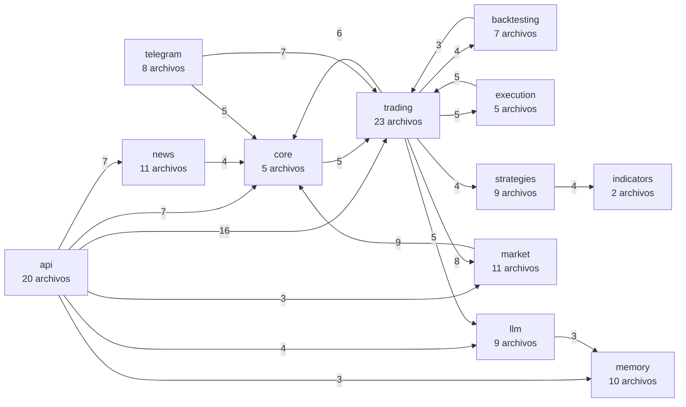

# Documentación técnica para desarrolladores

Esta carpeta es para quien **modifica el código** de Minerva: qué hace cada archivo y cada función, cómo
se conectan, qué no se puede tocar mientras la medición está en curso y cómo hacer los cambios comunes
sin romper nada. Si lo que quieres es instalar, operar o entender qué mide el proyecto, empieza por el
[índice general](../README.md).

> **Antes de cambiar nada que no sea documentación, lee [`ZONAS_PROTEGIDAS.md`](ZONAS_PROTEGIDAS.md).**
> Hay una medición en curso y varias partes del código, de la configuración y de la base la invalidarían
> si cambiaran. `python scripts/check_measurement_safety.py` te dice si lo que cambiaste toca alguna.

Minerva es **100 % paper trading**: nada de este código envía órdenes reales (la ejecución real existe
solo como interfaz documentada y desactivada, `BitunixBackend`).

## Los documentos

| Documento | Qué contiene |
|---|---|
| [ZONAS_PROTEGIDAS.md](ZONAS_PROTEGIDAS.md) | **El más importante.** Qué archivos, funciones, tablas y parámetros no se pueden cambiar durante la medición y por qué; qué sí se puede cambiar con seguridad; qué hacer si de verdad hay que cambiar algo protegido; cómo usar `scripts/check_measurement_safety.py` |
| [FLUJO_EJECUCION.md](FLUJO_EJECUCION.md) | El `lifespan` de `app/main.py` paso a paso, cada tarea asyncio y cómo se comunican, un cierre de vela de punta a punta, un reinicio y una parada |
| [MODELO_DATOS.md](MODELO_DATOS.md) | Las 28 tablas: para qué sirve cada una, quién la escribe y quién la lee, el disparador de inmutabilidad, las migraciones y cómo agregar una columna o una tabla sin romper una base existente |
| [ENTORNO_DESARROLLO.md](ENTORNO_DESARROLLO.md) | Preparar el entorno (Python, Node, Docker), correr el bot de desarrollo en el puerto 8001 con una copia de la base, depurar, ver logs, correr las pruebas por partes, `ruff`, y cómo se genera esta documentación |
| [PRUEBAS.md](PRUEBAS.md) | Cómo está organizado `tests/`, los fixtures y los falsos, cómo escribir una prueba nueva y las pruebas guardianas (prompt congelado, resultados ocultos, sin red, sin ventanas, documentación) con lo que protege cada una |
| [RECETAS.md](RECETAS.md) | Paso a paso de los cambios comunes (estrategia, indicador, comando de Telegram, endpoint, pestaña del dashboard, variable de configuración, fuente de noticias, parámetro de riesgo) y cómo desplegar un cambio al contenedor |
| [modulos/](modulos/) | Una guía por paquete de `app/`, una para `scripts/` y una para `frontend/src`, con **cada archivo**: responsabilidad, funciones clave, invariantes, tablas, a quién llama y quién lo llama, configuración, pruebas y trampas conocidas. Ver [el mapa del código](#mapa-del-código) |
| [api/](api/index.html) | La referencia automática (pdoc) de todos los módulos de `app/` y `scripts/`, generada desde los docstrings. Ver [la referencia automática](#la-referencia-automática-de-la-api-interna) |

## ¿Qué leo si quiero…?

| Quiero… | Lee |
|---|---|
| **Saber si un cambio mío es seguro para la medición** | [ZONAS_PROTEGIDAS](ZONAS_PROTEGIDAS.md) → `python scripts/check_measurement_safety.py` |
| **Entender qué pasa desde que cierra una vela hasta que se abre una posición** | [FLUJO_EJECUCION](FLUJO_EJECUCION.md#un-cierre-de-vela-de-punta-a-punta) → guías [trading](modulos/trading.md) y [llm](modulos/llm.md) |
| **Agregar o cambiar una estrategia** | [ZONAS_PROTEGIDAS](ZONAS_PROTEGIDAS.md#estrategias-y-parámetros) (durante la medición no se puede) → [RECETAS](RECETAS.md#agregar-una-estrategia) → guía [strategies](modulos/strategies.md) |
| **Agregar un comando de Telegram, un endpoint o una pestaña** | [RECETAS](RECETAS.md) → guías [telegram](modulos/telegram.md), [api](modulos/api.md), [frontend](modulos/frontend.md) |
| **Cambiar una variable de configuración** | [RECETAS](RECETAS.md#agregar-una-variable-de-configuración) → guía [config](modulos/config.md) |
| **Tocar la base de datos** | [MODELO_DATOS](MODELO_DATOS.md) → [ESQUEMA_BD](../ESQUEMA_BD.md) (generado) |
| **Correr el bot en mi equipo sin tocar el real** | [ENTORNO_DESARROLLO](ENTORNO_DESARROLLO.md#correr-el-bot-de-desarrollo-en-el-puerto-8001) |
| **Escribir una prueba** | [PRUEBAS](PRUEBAS.md#cómo-escribir-una-prueba-nueva) |
| **Desplegar un cambio al contenedor** | [RECETAS](RECETAS.md#desplegar-un-cambio-al-contenedor) |
| **Buscar una función concreta y su docstring** | [la referencia automática](api/index.html) |

## Mapa del código

```
app/            el bot (paquete Python)
  main.py         punto de entrada y lifespan: arma y arranca todo
  config.py       toda la configuración (pydantic-settings)
  core/           scheduler, logging que no bloquea, latido, cliente HTTP
  market/         clientes de Bitunix y CoinGecko, velas, funding, contratos, universo
  indicators/     indicadores técnicos (pandas puro)
  strategies/     las seis estrategias por reglas (la fuente de señales)
  trading/        generador de señales, sombras, etiquetador, brazo ejecutado, riesgo, monitor, medición
  llm/            prompt congelado, features, cliente, servicio de decisión, presupuesto
  execution/      la cuenta paper (PaperBackend), PnL, interfaz de ejecución real desactivada
  backtesting/    el backtest histórico de la Fase 2 (offline)
  persistence/    conexión, esquema, migraciones, modelos y repositorios
  api/            rutas HTTP de FastAPI (lectura, tres controles, login)
  telegram/       bot de comandos y notificaciones push
  news/           recolección de noticias y Fear & Greed
  memory/         memoria de lecciones
scripts/        herramientas de línea de comandos (no forman parte del bot en ejecución)
frontend/src/   el dashboard (React + TypeScript)
tests/          unit/, integration/, e2e/ y support/
docs/           documentación (esta carpeta es docs/dev/)
docker/         healthcheck, versiones exactas de la imagen y variables de Compose
```

| Paquete | Es | Guía |
|---|---|---|
| `app/main.py` y `app/__init__.py` | el punto de entrada: construye la aplicación, registra los routers y arma el bot en el `lifespan` | [main](modulos/main.md) |
| `app/config.py` | la clase `Settings` y la instancia `settings`; una variable de `.env` por campo | [config](modulos/config.md) |
| `app/core/` | el bucle del scheduler, el logging, el latido y el cliente HTTP | [core](modulos/core.md) |
| `app/market/` | datos de mercado públicos y el universo de activos | [market](modulos/market.md) |
| `app/indicators/` | EMA, ATR, RSI, Bollinger, Donchian (causales) | [indicators](modulos/indicators.md) |
| `app/strategies/` | las estrategias: dicen LONG, SHORT o HOLD, no abren nada | [strategies](modulos/strategies.md) |
| `app/trading/` | el núcleo operativo y el paquete más grande | [trading](modulos/trading.md) |
| `app/llm/` | todo lo que rodea la decisión de Claude sobre una señal | [llm](modulos/llm.md) |
| `app/execution/` | la cuenta paper y las fórmulas de PnL | [execution](modulos/execution.md) |
| `app/backtesting/` | el backtest histórico, offline | [backtesting](modulos/backtesting.md) |
| `app/persistence/` | una conexión, el esquema, las migraciones y un repositorio por grupo de tablas | [persistence](modulos/persistence.md) |
| `app/api/` | la API HTTP: lectura de estado y tres controles | [api](modulos/api.md) |
| `app/telegram/` | el bot de comandos y las notificaciones push | [telegram](modulos/telegram.md) |
| `app/news/` | noticias y Fear & Greed (sin costo, aisladas) | [news](modulos/news.md) |
| `app/memory/` | la memoria de lecciones (apagada durante la medición) | [memory](modulos/memory.md) |
| `scripts/` | las herramientas de línea de comandos | [scripts](modulos/scripts.md) |
| `frontend/src/` | el dashboard | [frontend](modulos/frontend.md) |

## Mapa de dependencias entre paquetes

<!-- grafo-paquetes -->


El diagrama muestra solo las flechas con 3 o más imports; no dibuja las que llegan a `config`, `persistence` (casi todos los paquetes las usan) ni las que salen de `main`, `scripts` (ensamblan todo). El número de cada flecha es la cantidad de imports. La tabla de abajo tiene todas las dependencias.

| Paquete | Archivos | Líneas | Importa de (imports) | Lo importan |
|---|---:|---:|---|---|
| `api` | 20 | 2246 | persistence 36, trading 16, config 11, core 7, news 7, llm 4, market 3, memory 3, telegram 2 | main, scripts, telegram |
| `backtesting` | 7 | 2063 | persistence 9, trading 3, config 2, core 2, market 2, strategies 2, execution 1 | scripts, trading |
| `config` | 1 | 423 | ninguno | api, backtesting, core, execution, llm, main, market, memory, news, scripts, telegram, trading |
| `core` | 5 | 593 | trading 5, persistence 4, config 2, market 2, execution 1 | api, backtesting, execution, llm, main, market, memory, news, scripts, telegram, trading |
| `execution` | 5 | 666 | persistence 7, trading 5, config 1, core 1, market 1 | backtesting, core, main, trading |
| `indicators` | 2 | 161 | ninguno | strategies |
| `llm` | 9 | 1478 | persistence 16, config 5, memory 3, core 1, market 1, news 1 | api, scripts, telegram, trading |
| `main` | 2 | 278 | api 16, market 4, trading 4, core 3, telegram 3, config 1, execution 1, memory 1, news 1, persistence 1 | ninguno |
| `market` | 11 | 1908 | persistence 13, core 9, config 1 | api, backtesting, core, execution, llm, main, scripts, telegram, trading |
| `memory` | 10 | 1252 | persistence 20, config 3, core 2, news 1, trading 1 | api, llm, main, scripts |
| `news` | 11 | 1703 | persistence 11, core 4, config 3 | api, llm, main, memory, scripts |
| `persistence` | 22 | 5016 | ninguno | api, backtesting, core, execution, llm, main, market, memory, news, scripts, telegram, trading |
| `scripts` | 32 | 8756 | trading 26, config 19, persistence 19, market 9, llm 6, backtesting 3, core 3, strategies 3, memory 2, news 2, api 1 | ninguno |
| `strategies` | 9 | 807 | indicators 4 | backtesting, scripts, trading |
| `telegram` | 8 | 1903 | persistence 12, trading 7, core 5, config 4, market 2, api 1, llm 1 | api, main |
| `trading` | 23 | 7441 | persistence 57, config 9, market 8, core 6, execution 5, llm 5, backtesting 4, strategies 4 | api, backtesting, core, execution, main, memory, scripts, telegram |
<!-- /grafo-paquetes -->

Dos cosas que conviene saber al leer el grafo:

- **Hay ciclos entre paquetes**, y están a la vista: `trading`, `core`, `market`, `execution`, `llm`,
  `memory`, `news` y `backtesting` forman un bloque que se importa entre sí, y `api` con `telegram`
  forman otro. No es un diseño por capas estrictas: es un conjunto de paquetes cohesivos. El único
  ciclo a nivel de módulo es `app.llm._anthropic_client` con `app.llm.client`, y se rompe con un
  `import` perezoso dentro de una función.
- **El grafo lo calcula el código** (`scripts/build_dev_docs.py`, leyendo los `import` de `app/` y
  `scripts/`); no se edita a mano. Una prueba falla si está desactualizado.

## La referencia automática de la API interna

[`api/index.html`](api/index.html) es la referencia **generada con [pdoc](https://pdoc.dev/)** a partir de
los docstrings de todos los módulos de `app/` y `scripts/`: una página por módulo, con sus funciones y
clases, firmas y lo que cada una hace.

- **Cómo verla:** abre el archivo `docs/dev/api/index.html` con tu navegador (en Windows,
  `start docs\dev\api\index.html`). Es HTML estático: no necesita servidor. En GitHub el repositorio la
  muestra como código, así que léela clonando el repositorio.
- **Qué contiene cada docstring:** el propósito, `Args`, `Returns`, `Raises` y una sección propia,
  `Efectos:`, con las tablas que lee y escribe, la red que usa, los mensajes de Telegram y los archivos
  que toca. Una prueba exige este formato para todo lo nuevo (ver
  [ENTORNO_DESARROLLO](ENTORNO_DESARROLLO.md#documentación-técnica)).
- **Se versiona y no se edita a mano.** `python scripts/build_dev_docs.py` la regenera; con `--check`
  solo verifica. Una prueba falla si no coincide con el código.
- **No incluye secretos ni rutas de tu equipo:** la generación corre en un proceso aparte con el
  entorno limpio y se rechaza si en el resultado queda una ruta local o algo con forma de credencial.

## Cómo está escrita y cómo se mantiene esta documentación

| Parte | Cómo se mantiene |
|---|---|
| `api/` | **Generada** desde los docstrings (`scripts/build_dev_docs.py`) |
| Los **hechos** de cada archivo en las guías de `modulos/` (qué importa, quién lo importa, configuración que lee, tablas que lee y escribe, pruebas que lo citan) y el grafo de arriba | **Generados** desde el código; están entre marcas `<!-- hechos:... -->` y no se editan |
| El resto de las guías de `modulos/` (responsabilidad, funciones clave, invariantes, trampas) y los demás documentos de esta carpeta | **Escritos a mano**, verificados leyendo el código |
| [`../ESQUEMA_BD.md`](../ESQUEMA_BD.md) | **Generado** (`python scripts/export_schema_doc.py`) |

Cada archivo en una guía de `modulos/` tiene la misma estructura: **Responsabilidad**, **Funciones y
clases clave**, **Invariantes — no romper**, **Trampas conocidas** y el bloque de hechos. Un archivo
nuevo en `app/` o `scripts/` hace que `python scripts/build_dev_docs.py` añada un borrador en su guía
con el texto `_Pendiente de documentar._`, y una prueba falla mientras quede alguno sin escribir.

Las pruebas que vigilan estos documentos: enlaces y anclas que resuelven, rutas del repositorio citadas
que existen, opciones de línea de comandos y rutas de la API que existen de verdad, tablas bien
formadas, y que la documentación generada esté al día (`tests/unit/test_dev_docs.py`,
`tests/unit/test_build_dev_docs.py` y `tests/unit/test_docstrings.py`).

## Lo no verificado

Cada documento tiene su sección "Lo no verificado" cuando hace falta. Lo más relevante:

- **Los modos de fallo de servicios externos** (Bitunix, CoinGecko, GDELT, la API de Anthropic) están
  descritos como los maneja el código, no como se observaron en producción; ver
  [`../COSTOS_Y_LIMITES.md`](../COSTOS_Y_LIMITES.md#lo-no-verificado).
- **La ejecución real** (`BitunixBackend`) es solo una interfaz: sus endpoints y firmas no se han
  verificado ni se usan.
- **Los hechos derivados** (qué tablas toca cada archivo, quién importa a quién) salen de un análisis
  estático del código (ve los `import` dentro de funciones, pero no `importlib` ni `__import__`). El
  SQL cuyo nombre de tabla se arma en tiempo de ejecución se aproxima con las tablas que aparecen como
  cadena en la misma función, y lo que pase por reflexión no se ve.
